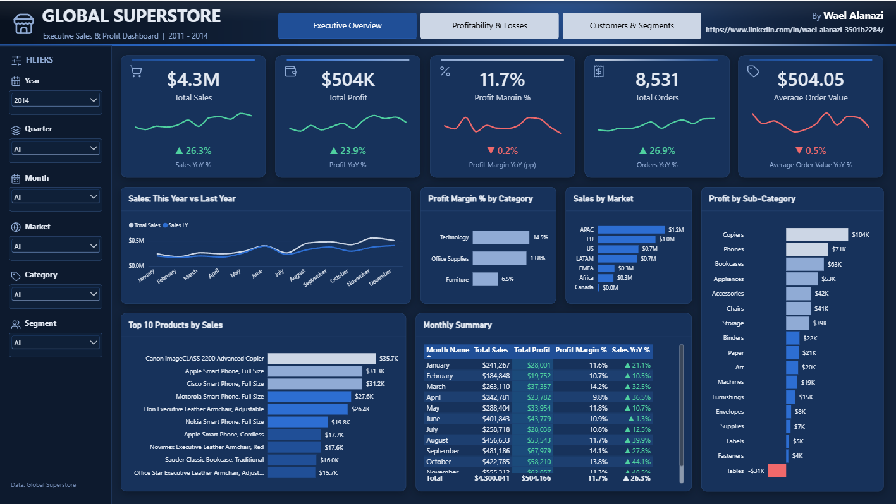
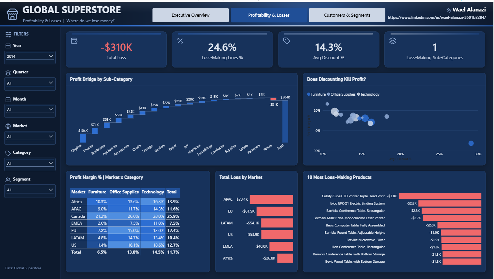
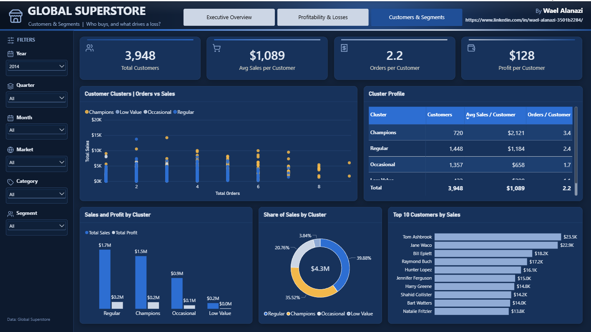
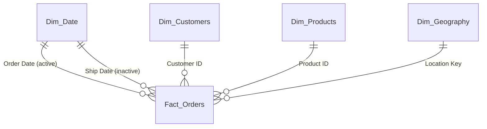
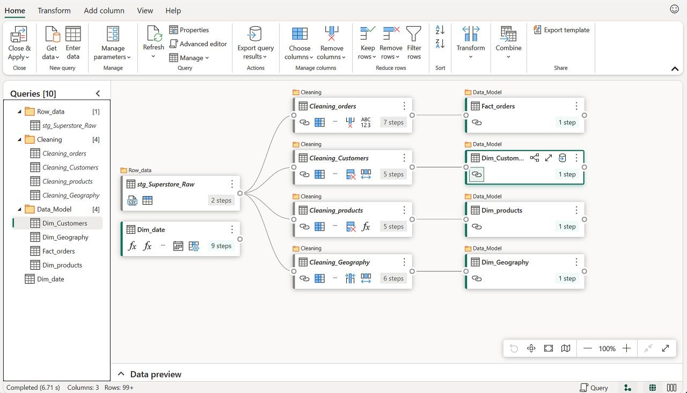
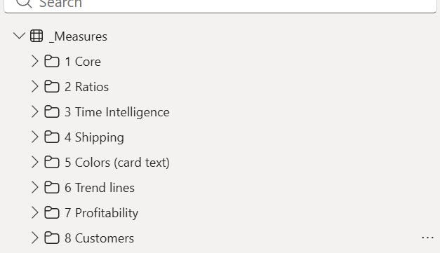

# Global Superstore: Executive Sales & Profit Dashboard

A three-page **Power BI** dashboard built on the Global Superstore sample (51,290 order lines, 2011-2014).
It answers three questions a business owner actually asks: *how are we doing, where do we lose money, and who are our best customers?*



## Business questions

| Page | Question | What you see |
|---|---|---|
| **Executive Overview** | How are sales, profit and margin trending vs last year? | KPI cards with year-over-year arrows and trend lines, sales this year vs last year, top products, profit by sub-category, monthly summary |
| **Profitability & Losses** | Where do we lose money? | Loss KPIs, profit bridge (waterfall), discount-vs-margin scatter, margin heat matrix, most loss-making products |
| **Customers & Segments** | Who buys, and what is each group worth? | K-Means customer clusters, cluster profile, share of sales by cluster, top customers |





## Highlights (2014 view)

- Sales **$4.3M (+26.3% YoY)** and profit **$504K (+23.9%)**, but the profit margin slipped slightly to **11.7% (-0.2 pp)**.
- **24.6%** of order lines lose money, adding up to about **-$310K**, with an average discount of **14.3%**. Only one sub-category (**Tables**) is loss-making overall (-$31K).
- Four customer clusters were found with K-Means on orders and sales per customer.
  **Champions are about 18% of customers (720 of 3,948) but about 36% of sales**, with 3.4 orders and $2,121 per customer on average.

## Data model

A star schema with one fact table and four dimensions. `Ship Date` is a second, **inactive** relationship to the date table, used through `USERELATIONSHIP` so shipping can be analysed without duplicating the date table.



| Table | Rows | Notes |
|---|---|---|
| `Fact_Orders` | 51,290 | Sales, profit, quantity, discount, shipping cost, dates. Calculated columns `Order Result` (Loss/Profit) and `Discount Band` |
| `Dim_Customers` | 4,873 | Customer, segment, and the K-Means `Customer clusters` column |
| `Dim_Products` | 10,292 | One row per `Product ID` |
| `Dim_Geography` | 3,819 | Keyed by `Location Key` (city, state, country, region, market) |
| `Dim_Date` | 2011-2015 | Extended to 2015 because some orders ship in January 2015 |

## Data preparation (Power Query)

Raw data goes through a **staging area** before it reaches the model: one raw staging query, four cleaning queries, and the final model tables.



- File path is a **parameter** (`Filepath`), so the project works on any machine.
- Text trimmed, types set, a `Location Key` built for the geography dimension.
- **457 product IDs had more than one product name.** Instead of keeping an arbitrary row, each ID keeps its most frequent name (group, sort, `Table.Buffer`, remove duplicates) so the dimension is unique and the choice is deterministic.

## DAX measures

51 measures grouped in display folders inside a dedicated `_Measures` table.



| Folder | Purpose | Examples |
|---|---|---|
| 1 Core | Base totals | `Total Sales`, `Total Profit`, `Total Orders` |
| 2 Ratios | Rates | `Profit Margin %`, `Average Order Value` |
| 3 Time Intelligence | Comparison with last year | `Sales LY`, `Sales YoY %` (using `SAMEPERIODLASTYEAR`) |
| 4 Shipping | Inactive relationship | `Sales by Ship Date` (using `USERELATIONSHIP`) |
| 5 Colors | Colour driven by data | `Sales YoY Color`, `Profit Cell Color`, `Margin Heat Color` |
| 6 Trend lines | Green/red sparklines | `Sales Trend Up`, `Sales Trend Down` |
| 7 Profitability | Loss analysis | `Total Loss`, `Loss-Making Lines %`, `Avg Discount %` |
| 8 Customers | Customer value | `Avg Sales per Customer`, `Profit per Customer` |

```dax
Sales YoY % =
DIVIDE([Total Sales] - [Sales LY], [Sales LY])

Sales LY =
CALCULATE([Total Sales], SAMEPERIODLASTYEAR(Dim_Date[Date]))
```

## Techniques worth noting

- **Conditional formatting from measures** ("field value"): the arrows, red/green numbers, table profit/loss cells and the margin heat matrix are all driven by small colour measures.
- **Two-series sparklines**: a line cannot change colour by rule, so each KPI plots an "up" and a "down" series, and only one of them has values.
- **Role-playing date dimension**: order date (active) and ship date (inactive) share one date table.
- **K-Means clustering in DAX** (`KMeansClustering`) on orders and sales per customer, with business-friendly cluster names.
- **Top N filters**, **page navigation links** in the header and **synced slicers** across pages.
- Stored as a **Power BI Project (PBIP)** with a TMDL model and PBIR report, so every change is readable and versioned in Git.

## How to run

1. Get the Global Superstore data as a tab-delimited text file with the 27 original columns (the file is **not** included in this repository).
2. Save it as `C:\Data\Global Superstore.txt`, or keep it anywhere and change the path in the next step.
3. Open `power bi Global Superstore.pbip` in Power BI Desktop (a version with Power BI Project support).
4. If your file is elsewhere: **Transform data -> Manage parameters**, set `Filepath` to its full path.
5. Click **Refresh**.

## Repository layout

```
.
├── power bi Global Superstore.pbip
├── power bi Global Superstore.SemanticModel/   model: tables, relationships, measures (TMDL)
├── power bi Global Superstore.Report/          report: pages, visuals, theme, icons (PBIR)
├── docs/images/                                screenshots used in this README
└── README.md
```

## Credits

- Data: the public *Global Superstore* sample dataset.
- Icons: [Lucide](https://lucide.dev) (ISC license).
- Built by **Wael Alanazi**: [LinkedIn](https://www.linkedin.com/in/wael-alanazi-3501b2284/) | [GitHub](https://github.com/wael-alanazi)
